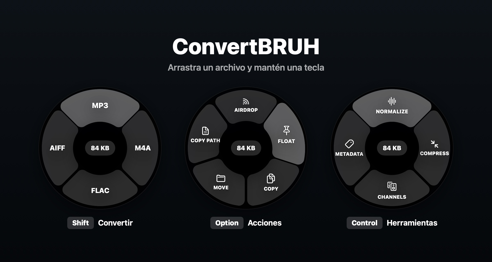

<div align="center">


# ConvertBRUH

**Convierte, comparte y procesa archivos sin soltarlos.**

[](https://github.com/pablo96sancho/ConvertBRUH/releases/latest/download/ConvertBRUH-Installer.dmg)


[🇬🇧 English version](./README.en.md)

</div>

<br />

<p align="center">
  
</p>

ConvertBRUH es una app de la barra de menú que muestra un anillo de opciones alrededor del
cursor mientras arrastras un archivo. Lo sueltas sobre una porción y listo: el resultado
aparece junto al original. Todo se hace en local y el original nunca se toca.

## Cómo funciona

1. Empieza a arrastrar uno o varios archivos desde el Finder, el Escritorio o Ableton.
2. Mientras arrastras, mantén **Shift**, **Option** o **Control**: aparece el anillo.
3. Suelta sobre una porción. Soltar en el centro cancela.
4. Al terminar, el resultado queda seleccionado en el Finder.

Puedes cambiar de tecla a mitad del arrastre y el anillo cambia con ella.

## Características

| Tecla | Anillo | Qué puedes hacer |
|---|---|---|
| ⇧ **Shift** | **Convertir** | Audio a MP3, WAV, M4A, FLAC o AIFF · imágenes a JPG, PNG, WEBP o PDF · vídeo a MP4, MOV o GIF, o sacar el audio · PDF a TXT, DOCX, JPG o PNG |
| ⌥ **Option** | **Acciones** | AirDrop · Float (miniatura flotante para arrastrar a otra app) · Copy · Move · Copy Path |
| ⌃ **Control** | **Herramientas** | Audio: Normalize (−14 LUFS), Compress, Channels y Metadata · Imagen: Compress, **Upscale ×4 con IA** y Metadata · Vídeo: Compress y Mute · PDF: Metadata |

- 🎧 **Calidad cuidada:** conserva bit depth, sample rate, tags y carátula. En vídeo copia sin recodificar siempre que se puede.
- 🧠 **Upscale con IA en local:** amplía imágenes ×4 con Real-ESRGAN en el Neural Engine del Mac, sin internet ni cuentas.
- 📦 **Lotes:** varios archivos a la vez, con el progreso en el centro del anillo.
- 🔒 **Nunca sobrescribe nada:** `beat.mp3`, `beat (1).mp3`…
- 💻 **Nativa y ligera:** Swift con SwiftUI y AppKit, sin icono en el Dock.

## Instalación

1. [Descarga el instalador](https://github.com/pablo96sancho/ConvertBRUH/releases/latest/download/ConvertBRUH-Installer.dmg).
2. Ábrelo y arrastra **ConvertBRUH.app** a **Aplicaciones**.
3. Ábrela. Aparecerá en la barra de menú.

### Primera apertura

La app no está firmada con una cuenta de Apple Developer, así que la primera vez macOS
la bloquea con un aviso. Para abrirla:

1. Intenta abrir ConvertBRUH y cierra el aviso (sin moverla a la Papelera).
2. Ve a **Ajustes del Sistema → Privacidad y seguridad**.
3. En la sección **Seguridad**, pulsa **Abrir igualmente** junto al mensaje sobre ConvertBRUH.
4. Confirma con tu contraseña o Touch ID. Solo hace falta la primera vez.

<details>
<summary>Alternativa desde la Terminal</summary>

```bash
xattr -dr com.apple.quarantine /Applications/ConvertBRUH.app
```

</details>

### Permisos

ConvertBRUH **no necesita permiso de Accesibilidad**. macOS puede pedirte acceso a carpetas
como **Escritorio**, **Documentos** o **Descargas** la primera vez que guarde un archivo en
ellas. Si una carpeta no admite escritura (un DMG montado, un disco de solo lectura…), el
resultado se guarda en **Descargas**.

## Desarrollo

Requisitos: macOS 13 o superior en Apple Silicon, Xcode 15+ (Xcode 26+ para compilar el
icono de Icon Composer) y Swift 5.9+.

```bash
./build_and_run.sh   # descarga ffmpeg la primera vez, compila, instala en /Applications y abre
swift test           # tests
./create_dmg.sh      # genera ConvertBRUH-Installer.dmg
```

Cada Release de GitHub publica el DMG automáticamente con GitHub Actions.

## Licencia

[GPL-3.0](LICENSE) © Pablo Sancho

ConvertBRUH incluye [FFmpeg](https://ffmpeg.org) (GPL v3) como binario independiente y el
modelo [Real-ESRGAN](https://github.com/xinntao/Real-ESRGAN) (BSD-3-Clause). Sus avisos
están en [`Resources/LICENSES`](Resources/LICENSES).
